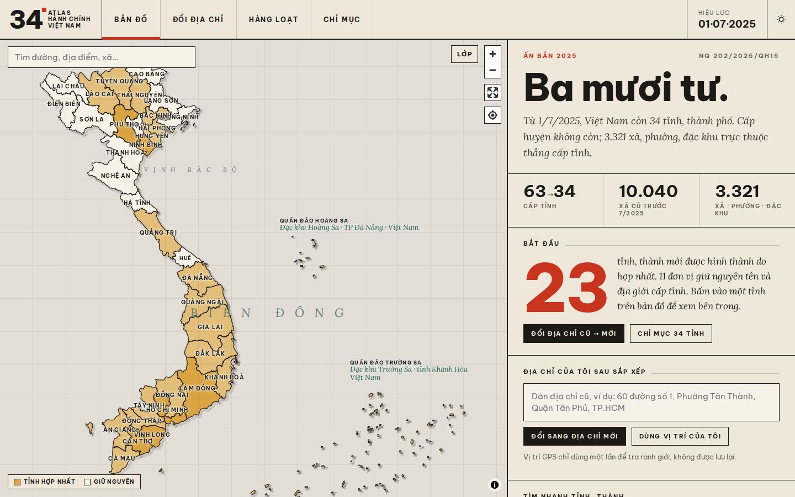
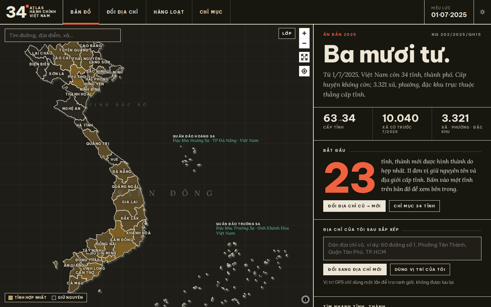
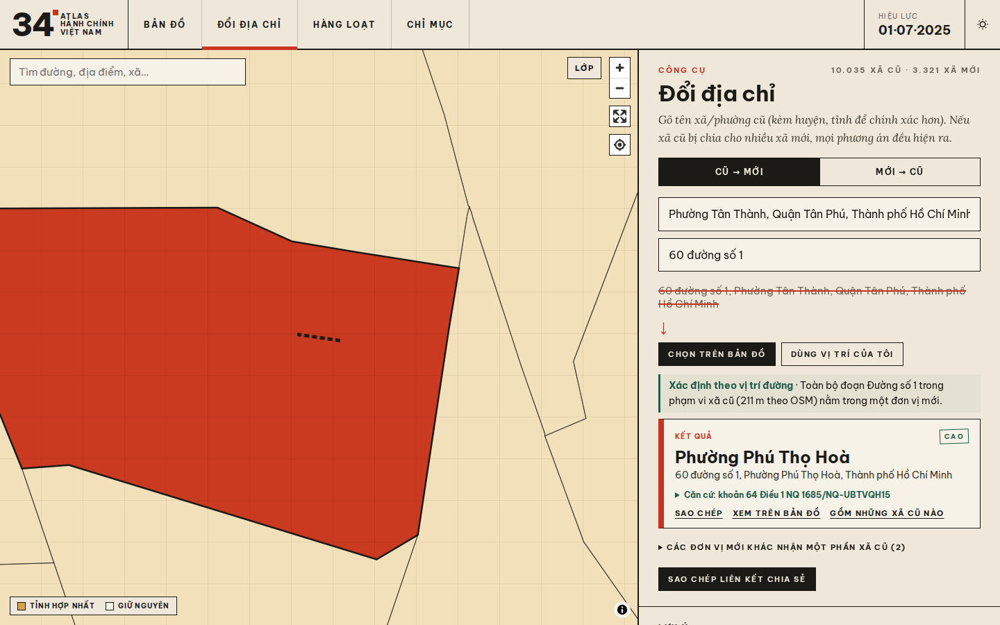
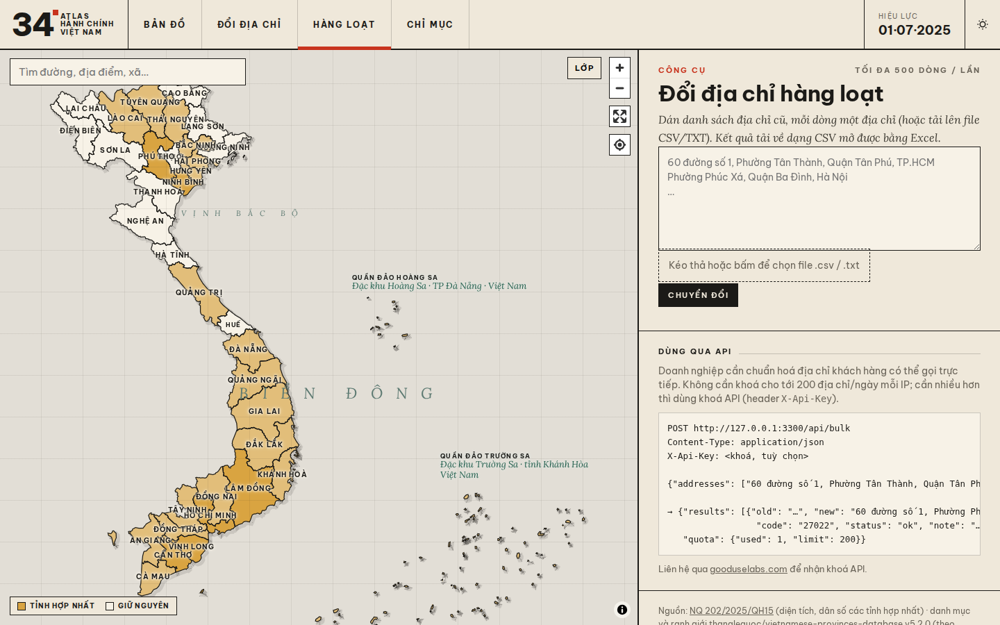
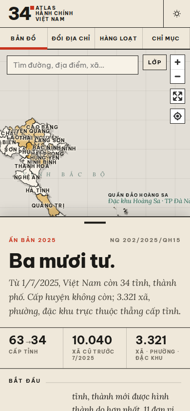
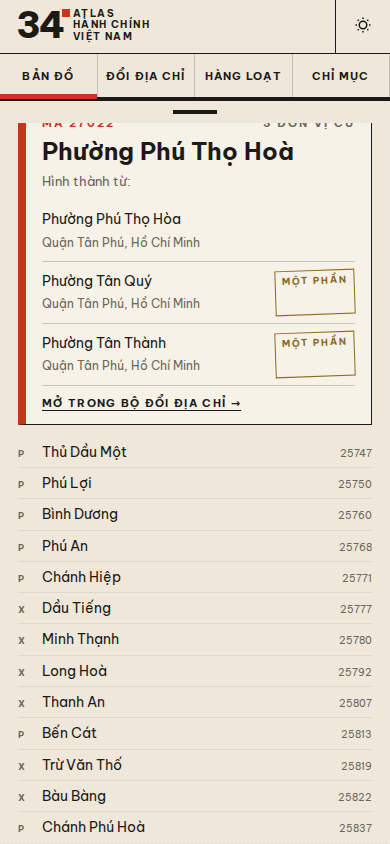
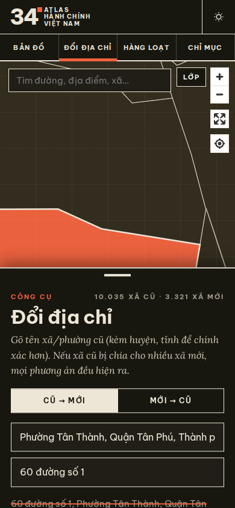
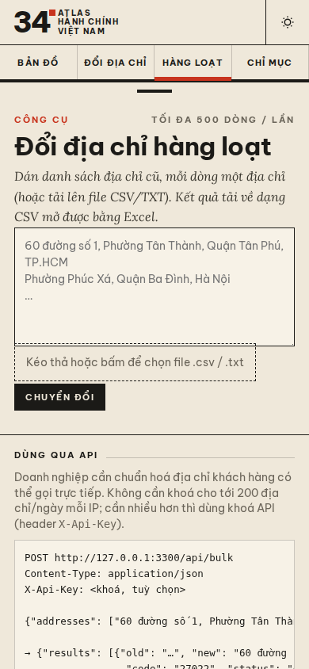

# Atlas 34 — Bản đồ hành chính Việt Nam sau sắp xếp 2025

**Web:** https://gooduselabs.github.io/atlas34/

🇻🇳 Bản đồ 34 tỉnh/thành và 3.321 xã/phường/đặc khu (từ 1/7/2025). Có công cụ đổi địa chỉ cũ ↔ mới. Với xã cũ bị chia cho nhiều xã mới, trang xác định đúng đơn vị mới theo số nhà/đường (OpenStreetMap), theo điểm chọn trên bản đồ hoặc theo GPS, kèm trích dẫn nghị quyết. Mỗi tỉnh có trang riêng: các tỉnh cũ đã hợp nhất, diện tích/dân số (NQ 202/2025/QH15), lãnh đạo có ghi nguồn, danh sách xã.

🇬🇧 Interactive atlas of Vietnam's 34 provinces and 3,321 communes after the 2025 reform. It includes an old ↔ new address converter that resolves split communes by house number or street (OSM), by map click or by GPS, with legal citations. Each province page lists the merged old provinces, area and population, sourced leaders and communes.

 
 
   

## Tính năng / Features
- **Bản đồ** 34 tỉnh → 3.321 xã, nền đường phố OSM tự host (PMTiles), ảnh vệ tinh, trụ sở UBND xã; **giao diện sáng/tối** (nút trên thanh đầu, tự theo hệ điều hành). / Map, OSM basemap, satellite, light/dark theme.
- **Đổi địa chỉ cũ ↔ mới**: gõ tên xã cũ, hoặc **dán nguyên địa chỉ** ("60 đường số 1, P. Tân Thành, Q. Tân Phú, TP.HCM"); xã bị chia được xác định theo số nhà/đường (OSM), điểm chọn trên bản đồ hoặc **GPS**, kèm trích dẫn nghị quyết. / Old ↔ new converter, paste a full address, GPS.
- **Đổi hàng loạt** (`/hang-loat`): dán danh sách hoặc kéo thả CSV/TXT ≤ 500 dòng → bảng kết quả 3 mức tin cậy → tải CSV. Chạy hoàn toàn trên trình duyệt ở bản GitHub Pages. / Bulk converter with CSV export.
- **API** `POST /api/bulk` (bản Docker): 200 địa chỉ/ngày/IP miễn phí; khoá API (`X-Api-Key`) nâng hạn mức, tạo trong `/admin` → *Khoá API*. / Bulk API with API keys.
- **Trang riêng cho từng xã** `/xa/<slug>-<mã>` (3.321 trang, có SEO + sitemap) và từng tỉnh `/tinh/<slug>`. / Per-ward and per-province pages.
- Di động: nội dung là bảng kéo lên/xuống trên bản đồ; tra cứu gần đây lưu trên máy. / Mobile bottom-sheet, recent searches.

### API hàng loạt / Bulk API
```bash
curl -X POST https://<host>/api/bulk -H 'Content-Type: application/json' -H 'X-Api-Key: a34_…' \
  -d '{"addresses":["60 đường số 1, Phường Tân Thành, Quận Tân Phú, TP.HCM"]}'
# → {"results":[{"old":"…","new":"60 đường số 1, Phường Phú Thọ Hoà, Thành phố Hồ Chí Minh","code":"27022","status":"ok","note":"Xác định theo vị trí đường"}],"quota":{"used":1,"limit":10000}}
```
`status`: `ok` chắc chắn · `warn` cần kiểm tra (xã cũ bị chia, hoặc trùng tên) · `bad` không nhận ra. Biến môi trường `BULK_FREE_LIMIT` (mặc định 200).

## Chạy / Run
- **GitHub Pages (tĩnh / static):** `cd app && npm ci && BASE=/atlas34 node scripts/build-static.mjs` → `app/dist`. Mỗi lần push lên `main`, `.github/workflows/pages.yml` tự triển khai.
- **Docker (có trang quản trị / with admin):** `cp .env.example .env` (đặt `ADMIN_PASSWORD`) → `docker compose up -d --build` → `http://host:3300`, `/admin`.

## Dữ liệu / Data
- `pipeline/run.sh` dựng lại toàn bộ dữ liệu (rebuilds all data) và kiểm đếm 34/3.321 với provinces.open-api.vn.
- Lãnh đạo và thông tin tỉnh nằm trong `app/content/leaders.json` và `app/content/facts.json` (sửa trực tiếp / edit directly). Muốn duyệt một mục thì đặt `"status": "approved"`.
- Mỗi thứ Hai, `leaders.yml` chạy lại pipeline lãnh đạo (Wikipedia → Wikidata → cổng TTĐT) và mở Pull Request để bạn duyệt (weekly PR for review).
- Nguồn và giấy phép / Sources & licenses: [ATTRIBUTION.md](ATTRIBUTION.md).

## Bản đồ nền đường phố (OSM vector) / Street basemap
- Planetiler (OpenMapTiles schema) từ Geofabrik Vietnam → `vietnam.pmtiles` (z0–14, ~304 MiB), tách bằng `pmtiles extract` thành 6 file < 100 MB: `vn-lo` (z0–11) + `vn-nw/ne/nc/sc/s` (z12–14, ranh theo lưới tile z12 nên không chồng lấn). Manifest: `app/tiles/tiles.json`.
- Hosting: file `.pmtiles` là asset của GitHub Release `basemap-tiles` (không commit vào git). `pages.yml` tải về `app/tiles/` lúc build → Pages phục vụ cùng site (Range OK). Bản Mac Docker mount `./app/tiles:/app/tiles:ro`, Express phục vụ `/tiles` có Range + CORS.
- Tái tạo: `docker run -v $PWD:/data ghcr.io/onthegomap/planetiler --download --area=vietnam --output=/data/vietnam.pmtiles --maxzoom=14`, rồi tách như trên.
- Chủ quyền: ẩn ranh giới biển/tranh chấp, ẩn tên biển/đảo nước ngoài; mặt nạ biển phía đông; Hoàng Sa (Đà Nẵng), Trường Sa (Khánh Hòa) luôn hiển thị từ lớp hành chính. Nhãn "Biển Đông".
- Ảnh vệ tinh tùy chọn: EOX Sentinel-2 cloudless 2016 (CC BY 4.0), tối đa z13.
- © OpenStreetMap contributors (ODbL) · © OpenMapTiles.

## Xác thực lãnh đạo qua báo Chính phủ
`cd app && npm run news-verify` tìm trên https://xaydungchinhsach.chinhphu.vn (tìm theo tên và theo "<chức danh> <tỉnh>", chỉ bài từ 01/07/2025), ghi nguồn bài báo (tiêu đề, link, ngày) vào `content/leaders.json` (`news`). Bài mới hơn bổ nhiệm người khác → cập nhật ứng viên + cờ `news_updated`; mâu thuẫn không rõ → cờ `news_conflict` để admin duyệt. Crawler lịch sự (UA rõ ràng, kiểm tra robots.txt, ≥1,5 s/yêu cầu). Docker tự đồng bộ kết quả mới từ `content/` khi khởi động.
